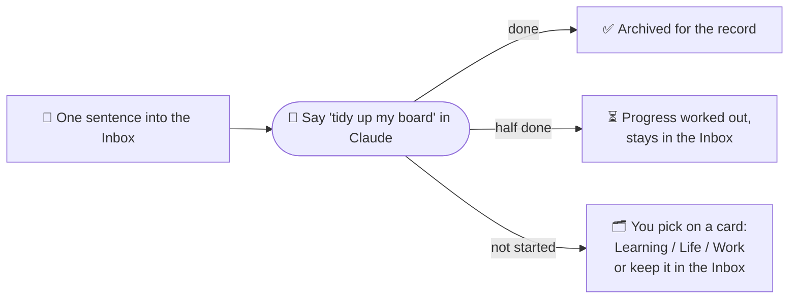

# reminder-brain · Give your to-do list a brain

**English** | [中文](README.zh-CN.md)

> Keep your to-dos in Notion and let Claude tidy them up. Jot things down in a sentence, say "tidy up my board" once a week, and Claude archives what's done, works out progress, and sorts the rest into categories.

**reminder-brain is a ready-made to-do system**: your to-dos live in Notion, and Claude acts as your personal organiser. You just jot things down and tick them off; the tiring parts like sorting, archiving and tracking progress are handled by Claude, following rules already written for it.

Setting it up takes no code and no software: copy a few pieces of text from [`prompts/en/`](prompts/en/) to Claude, and it builds the tables in your Notion and learns the rules. The rules are plain text, so you can change anything.

> 🔍 **See it in action first**: the [reminder-brain example page](https://reminder-brain.notion.site/reminder-brain-Example-4002191a0dfe80ae81eaef157ec527b0) is a public example built in Notion, with made-up items. Open it to see what the finished setup looks like, or duplicate it into your own Notion for reference.

> 🔍 **See it in action first**: the [reminder-brain example page](https://reminder-brain.notion.site/reminder-brain-Example-4002191a0dfe80ae81eaef157ec527b0) is a public example built in Notion, with made-up items. Open it to see what the finished setup looks like, or duplicate it into your own Notion for reference.

> 🔍 **See it in action first**: the [reminder-brain example page](https://reminder-brain.notion.site/reminder-brain-Example-4002191a0dfe80ae81eaef157ec527b0) is a public example built in Notion, with made-up items. Open it to see what the finished setup looks like, or duplicate it into your own Notion for reference.

> 🤖 **Works with Claude and ChatGPT**: same prompts for both; ChatGPT users see [`docs/en/chatgpt.md`](docs/en/chatgpt.md).

> 👉 **Want to jump in?** See [Get started in 5 steps](#get-started-in-5-steps) below, or the full walkthrough in [`docs/en/setup.md`](docs/en/setup.md).

---

## What problem it solves

The built-in Reminders app on your iPhone or Mac is easy to jot into, but it gets messy fast, because there's no brain helping you think: sorting every item into a list by hand is tiring and slow; long-term goals sit next to today's errands; half-finished things give no hint of how far along they are; and with so many old items piling up, sorting through them all at once is hard, so the list just keeps getting more bloated. All of this is because the built-in Reminders app doesn't come with a brain.

reminder-brain works like this:

- **Capture without thinking**: everything goes into the "Inbox" first, one sentence is enough.
- **Let Claude tidy**: just say "tidy up my board" in your Claude chat, and Claude goes through your Notion and cleans up by the rules already written for it.
- **You make the calls that matter**: Claude suggests where things go; you confirm with a tap on a choice card.
- ⭐ **Everything you've done stays, becoming your personal knowledge base**: **every item you log is kept in Notion. You can ask Claude to analyse what you've been doing over the long and short term, to help you plan and build a personal knowledge base.**
- ⭐ **Have you been keeping things in Apple Reminders? No need to start over**: one command on a Mac exports all of Reminders for Claude, and every list, the order, sections and subtasks move into Notion as they are. Nothing you've noted is lost, and Claude helps you tidy it up from there. That's how we moved over ourselves; see [`docs/en/apple-reminders.md`](docs/en/apple-reminders.md).

## How it works

Everything goes into the Inbox, one sentence each, no categorising needed. Just do it. After a while, when you've finished things or have progress you want to update in Notion, type "tidy up my board" in this Claude project (if you forget to tidy up, a weekly scheduled reminder will nudge you). Claude sends each Inbox item to one of three places:



**Tables in Notion** (categories are up to you; the default is Learning / Life / Work):

| Table | Purpose |
|---|---|
| Inbox | A one-week holding area: jot and tick |
| Learning / Life / Work | One to-do table per category, organised by group |
| Learning · Log etc. | What got done in each category |
| Archive | Everything done, tagged "Category · Group" |

**When you tidy up, Claude does four things:**
1. **Archive what's done** (automatic, no questions): for each ticked item, Claude decides whether it belongs to Learning, Life or Work, files it in that category's Log, keeps a copy in the Archive, then moves the original to the trash.
2. **Work out progress** (automatic, no questions): reads the checkboxes in each page body; 1 of 3 ticked becomes 33. It never overwrites a number you entered.
3. **Ask you to categorise**: for each item that's neither done nor in progress, a choice card: A suggested category / B alternative / C don't categorise, keep it in the Inbox (handy for urgent things you want to keep an eye on). Just tap one.
4. **Wrap up**: checks that the sorting in Notion hasn't been messed up, then gives you a summary of what this tidy-up changed.

**Tracking progress:** tick small things when done. For things with 1–3 steps, write checkboxes in the page body and tick them as you go. No sub-tasks needed.

## Get started in 5 steps

1. **Connect Notion**: add Notion under Connectors in Claude's settings.
2. **Create a project**: create a project in Claude and paste [`prompts/en/project-instructions.md`](prompts/en/project-instructions.md) into its instructions.
3. **Have Claude build the tables**: start a new chat in the project and send [`prompts/en/setup-notion.md`](prompts/en/setup-notion.md). Claude asks which categories you want, then builds everything.
4. **Click two things yourself**: show "Progress" as a bar, and give the Inbox a default template (Claude can't change these two; [here's why](docs/en/notion-limits.md)).
5. **Try it**: jot a few items, tick one, and say "tidy up my board".

Full steps in [`docs/en/setup.md`](docs/en/setup.md).

## What's in the repo

```
README.md / README.zh-CN.md     This document (English / Chinese)
LICENSE                         MIT license
config/
  categories.example.md         Default categories, and how to swap in your own
prompts/en/  prompts/zh/
  project-instructions.md       Project instructions: the full tidy-up rules
  setup-notion.md               Setup prompt: Claude builds every table in your Notion
  weekly-reminder.md            Weekly reminder scheduled-task template (optional)
docs/en/  docs/zh/
  setup.md                      Detailed setup
  customize.md                  Changing categories, stars, reminder time, the tidy-up flow
  notion-limits.md              What Claude can change and what you click in Notion
  apple-reminders.md            Optional: import from Apple Reminders (full Mac export)
  faq.md                        FAQ
  chatgpt.md                    Notes for ChatGPT users
  example.md                    Example: before and after one tidy-up
```

## Make it your own

Everything can change: categories and groups, the star rating, the reminder time, the tidy-up flow, even the whole purpose (a reading list, household chores…). Most changes are one sentence to Claude; see [`docs/en/customize.md`](docs/en/customize.md).

## Requirements

- A Notion account (free plan is enough)
- A Claude account with Projects and the Notion connector (or a ChatGPT account, see [`docs/en/chatgpt.md`](docs/en/chatgpt.md))
- (Optional) scheduled tasks, for the weekly reminder

## License

[MIT](LICENSE). Use it, change it, share it, including commercially.

## Background

These rules come from the author's own daily to-do system, refined over several rounds: Notion sub-tasks were tried and felt too heavy, so it settled on checkboxes in the page body plus Claude working out progress. All examples in this repo are made up.

Issues and PRs welcome, and so are your own variations.
