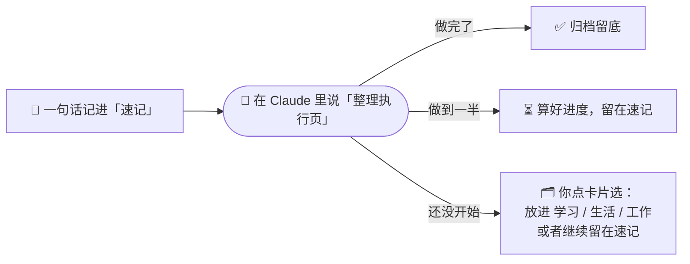

# reminder-brain · 给提醒事项装一个大脑

[English](README.md) | **中文**

> 用 Notion 记待办，让 Claude 帮你整理。随手记一句话，每周说一声「整理执行页」，Claude 会帮你归档做完的、算好进度、把没做完的分门别类。

**reminder-brain 是一个现成的待办整理系统**：你的待办记在 Notion 里，Claude 当你的整理助理。你只管随手记、做完打勾；分类、归档、算进度这些费脑的事，交给 Claude 按写好的规则来做。

搭起来不用写代码，也不用装任何软件：把 [`prompts/zh/`](prompts/zh/) 里的几段文字复制给 Claude，它就会在你的 Notion 里建好表、记住整理规则。规则全部是普通文字，想怎么改都行。

> 🔍 **先看看效果**：[reminder-brain 示例页](https://reminder-brain.notion.site/reminder-brain-Example-4002191a0dfe80ae81eaef157ec527b0)是用 Notion 搭好的公开示例，条目都是虚构的。打开就能看到搭好以后长什么样，也可以复制到自己的 Notion 里参考。

> 👉 **想直接上手？** 看下面的 [5 步上手](#5-步上手)，详细步骤见 [`docs/zh/setup.md`](docs/zh/setup.md)。

---

## 它解决什么问题

Apple 自带 / 手机里面的提醒事项 App 很好记，但记多了就乱，没有一个大脑来帮助我思考：比如每次都要手动分类，很费劲费时；长期的事和今天的事混在一起；做到一半的事也看不出做到哪了；曾经记过的项目太多，想一起整理很难，提醒事项的内容会变得很臃肿。这些都是因为手机自带的提醒事项 App 没有安装一个大脑。

reminder-brain 的做法是：

- **记的时候不用想**：所有事都先丢进「速记」，一句话就行。
- **整理交给 Claude**：可以和你的 Claude 对话框说一句「整理执行页」，Claude 读一遍你的 Notion，按已经写好的规则帮你收拾。
- **重要的决定你来做**：分到哪一类，Claude 给建议，你在选择卡片上点一下确认。
- ⭐ **做过的事都会留下来，成为你的个人信息库**：**所有你录入的事项都会保存在 Notion 里。你可以让 Claude 大脑对你长期、短期做的事情进行分析，更有利于你做规划、构建个人信息库。**
- ⭐ **已经习惯用 Apple 提醒事项记事？不用从头再来**：在 Mac 上用一条命令把整个提醒事项导出来交给 Claude，所有列表、顺序、分组、子任务都能原样搬进 Notion，之前记下的东西一条不丢，再由 Claude 帮你慢慢整理。我们自己就是这样搬过来的，步骤见 [`docs/zh/apple-reminders.md`](docs/zh/apple-reminders.md)。

## 它是怎么运作的

平时所有事都记在「速记」里，一句话就行，不用想分类，干就完事了。等过一段时间做完了、或者有进展想在 Notion 里更新时，在 Claude 的这个项目里输入「整理执行页」（忘了手动整理也没关系，每周会有定时提醒）。Claude 会把速记里的每一条分到三个去处：



**Notion 里的表**（大类可以随便改，默认是学习 / 生活 / 工作）：

| 表 | 作用 |
|---|---|
| 速记 | 一周的暂存区，随手记、随手勾 |
| 学习 / 生活 / 工作 | 每个大类一张待办表，按分组排好 |
| 学习 · 足迹 等 | 每个大类做完的事 |
| 完成档案 | 所有做完的事，带「大类 · 分组」标签 |

**整理执行页时 Claude 做四件事：**
1. **归档做完的**（自动，不问你）：打勾完成的，Claude 自动判断属于学习、生活还是工作，直接放进那个大类的足迹，同时在完成档案里留一份，再把原条目放进废纸篓。
2. **算进度**（自动，不问你）：读正文里的勾选框，3 步勾了 1 步就填 33。你自己填过的进度不覆盖。
3. **问你分类**：没完成、也没在推进的，每条一张选择卡片：A 建议分类 / B 备选分类 / C 不分类，留在速记（适合比较紧急、想随时盯着的事）。你点一下就行。
4. **收尾**：检查 Notion 里的排序有没有乱，再给你一份这次整理改动了什么的总结。

**进度怎么记：** 小事做完直接打勾。有 1–3 步的事，在正文里写勾选框，做一步勾一步，不用子任务。

## 5 步上手

1. **连 Notion**：在 Claude 设置的「连接器」里添加 Notion。
2. **建项目**：在 Claude 里新建一个项目，把 [`prompts/zh/project-instructions.md`](prompts/zh/project-instructions.md) 粘贴进项目说明。
3. **让 Claude 建表**：在项目里开新对话，发送 [`prompts/zh/setup-notion.md`](prompts/zh/setup-notion.md)。Claude 会先问你用什么分类，再自动建好所有表。
4. **手动点两下**：把「进度」设成进度条，给速记设一个默认模板（Claude 改不了这两项，[原因](docs/zh/notion-limits.md)）。
5. **试一下**：随手记几条，勾掉一条，说「整理执行页」。

详细步骤见 [`docs/zh/setup.md`](docs/zh/setup.md)。

## 仓库里有什么

```
README.md / README.zh-CN.md     说明文档（英文 / 中文）
LICENSE                         MIT 开源协议
config/
  categories.example.md         默认分类，以及怎么换成你自己的
prompts/zh/  prompts/en/
  project-instructions.md       项目说明：整理规则全文
  setup-notion.md               搭建提示词：让 Claude 在你的 Notion 里建好所有表
  weekly-reminder.md            每周提醒的定时任务模板（可选）
docs/zh/  docs/en/
  setup.md                      详细搭建步骤
  customize.md                  怎么改：分类、打星、提醒时间、整理流程
  notion-limits.md              Claude 能改什么，什么要你自己在 Notion 里点
  apple-reminders.md            可选：从 Apple 提醒事项导入（Mac 整库导出）
  faq.md                        常见问题
  example.md                    示例：一次整理前后的样子
```

## 改成你自己的

所有东西都可以改：大类和分组、打星标准、提醒时间、整理流程，甚至整套用途（读书清单、家庭分工……）。大部分改动直接跟 Claude 说一句就行，见 [`docs/zh/customize.md`](docs/zh/customize.md)。

## 需要什么

- Notion 账号（免费版就够）
- 能用「项目」和 Notion 连接器的 Claude 账号
- （可选）定时任务功能，用于每周提醒

## 开源协议

[MIT](LICENSE)。随便用、随便改、随便分享，商用也可以。

## 来历

这套规则来自作者自己每天用的待办系统，经过几轮迭代：试过 Notion 的子任务，觉得太重，最后改成「正文勾选框 + Claude 算进度」。仓库里的示例全部是虚构的。

欢迎提 Issue 和 PR，也欢迎分享你改出来的版本。
